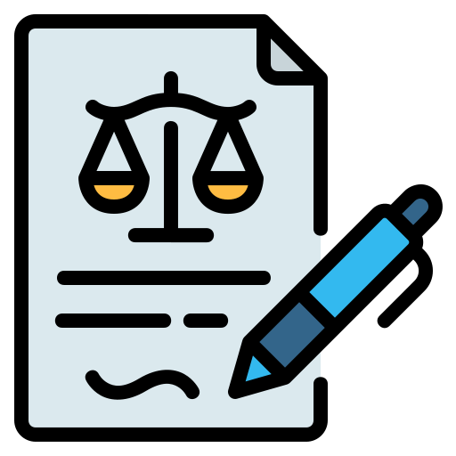
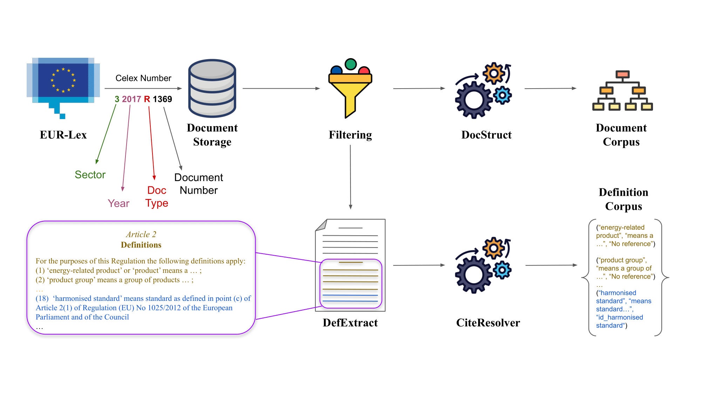
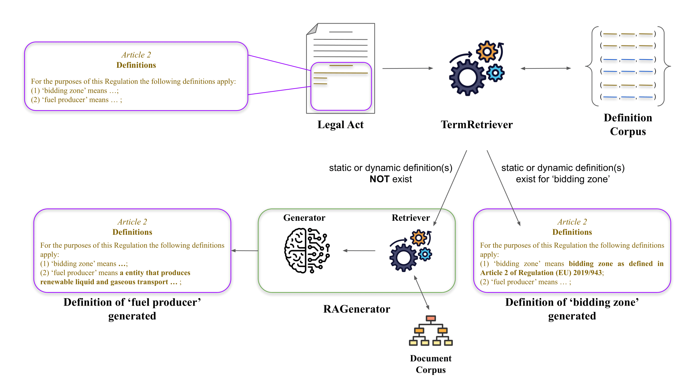

<a name="readme-top"></a>

<div align="center">

  

  # LexDrafter

  ### AI-Powered Legal Document Drafting with Retrieval-Augmented Generation

  **Developed and maintained by Ahmad Zafar Khan**

  [](https://github.com/azafar224)
  [](https://github.com/azafar224/LexDrafter/issues)
  [](https://github.com/azafar224/LexDrafter/stargazers)
  [](LICENSE)

  **[Report a Bug](https://github.com/azafar224/LexDrafter/issues) · [Request a Feature](https://github.com/azafar224/LexDrafter/issues)**

</div>

---

## About LexDrafter

LexDrafter is an AI-powered legal terminology drafting system designed to help create consistent, context-aware definitions for legislative and regulatory documents.

I work with retrieval-augmented generation (RAG), document processing, information retrieval, and large language models to support a workflow that identifies existing legal definitions and generates candidate definitions when additional context is needed.

The goal is to make legal document drafting more efficient, improve terminology consistency, and reduce ambiguity across complex regulatory documents.

## Key Features

- **Intelligent Definition Retrieval:** Retrieve existing definitions from a searchable collection of legal documents.
- **Context-Aware Generation:** Generate candidate definitions using relevant document passages and RAG.
- **Document Processing:** Extract and organize document structures, sections, metadata, and terminology.
- **Citation Resolution:** Process references associated with dynamic definition fragments.
- **LLM Integration:** Use language models to generate contextually relevant legal definitions.
- **Automated Evaluation:** Evaluate generated definitions using BLEU, BERTScore, and BLEURT metrics.

## How It Works

LexDrafter organizes the workflow into two main stages.

### 1. Document Ingestion and Knowledge Base Construction

Legal documents are collected, processed, and indexed. Relevant definitions are extracted and organized into a searchable knowledge base.



### 2. Definition Retrieval and Generation

When a user selects a term, the system searches for existing definitions. If an appropriate definition is unavailable, the RAG pipeline uses relevant context to generate a candidate definition.



## Technology Stack

| Technology | Purpose |
|---|---|
| Python | Core implementation |
| Retrieval-Augmented Generation | Context-grounded definition generation |
| OpenSearch | Document indexing and retrieval |
| PostgreSQL | Structured data storage |
| Hugging Face Transformers | Language model integration |
| LLaMA 2 and Vicuna | Definition generation |
| BLEU, BERTScore, BLEURT | Definition evaluation |

## Getting Started

### Prerequisites

- Python 3.9 or a compatible version
- OpenSearch
- PostgreSQL
- Hugging Face credentials for the relevant models

### Installation

Clone the repository:

```bash
git clone https://github.com/azafar224/LexDrafter.git
cd LexDrafter
```

Create and activate a virtual environment:

```bash
python -m venv .venv
```

Linux/macOS:

```bash
source .venv/bin/activate
```

Windows PowerShell:

```powershell
.venv\Scripts\Activate.ps1
```

Install dependencies:

```bash
pip install -r requirements.txt
```

### Environment Configuration

Rename `.env_example` to `.env` and configure the required credentials.

```dotenv
LOG_EXE_PATH="logs/execution.log"
LOG_PATH="logs/"

DB_USERNAME="your_opensearch_username"
DB_PASSWORD="your_opensearch_password"
DB_HOSTNAME="your_opensearch_hostname"
DB_PORT="your_opensearch_port"
DB_LEXDRAFTER_INDEX="your_opensearch_index_name"

PG_USER="your_postgres_username"
PG_PWD="your_postgres_password"
PG_DATABASE="your_postgres_database"
PG_SERVER="your_postgres_hostname"
PG_HOST="your_postgres_port"

HUGGINGFACE_AUTH_KEY="your_huggingface_auth_key"
```

Use the exact variable names required by the implementation and keep credentials out of version control.

## Project Structure

The implementation includes components for:

1. Dataset collection
2. Document structure processing
3. Definition extraction
4. Citation resolution
5. Term retrieval
6. RAG-based definition generation
7. Definition evaluation

Refer to the repository's `code/` directory for the implementation details.

## License

See the [`LICENSE`](LICENSE) file for the terms governing use, modification, and redistribution. Preserve any required third-party notices and attribution when distributing derivative work.

## Contact

**Ahmad Zafar Khan**

- GitHub: [@azafar224](https://github.com/azafar224)
- Portfolio: [ahmad-zafar-portfolio.vercel.app](https://ahmad-zafar-portfolio.vercel.app/)
- Project Issues: [GitHub Issues](https://github.com/azafar224/LexDrafter/issues)

---

<p align="center">
  Built and maintained by <a href="https://github.com/azafar224">Ahmad Zafar Khan</a>
</p>
